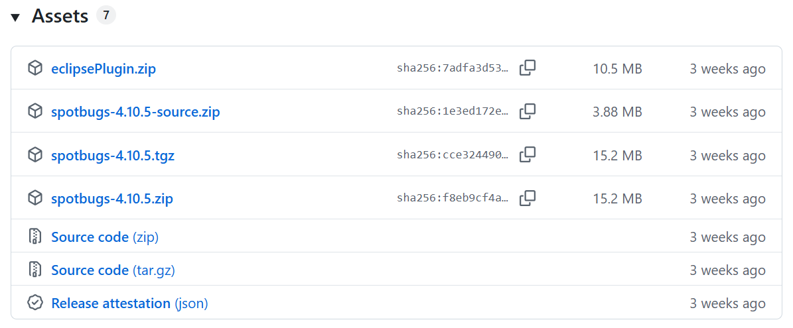
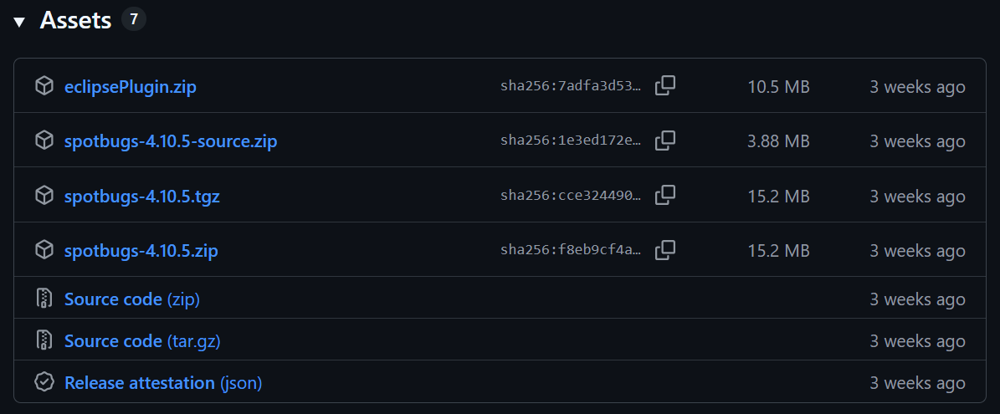
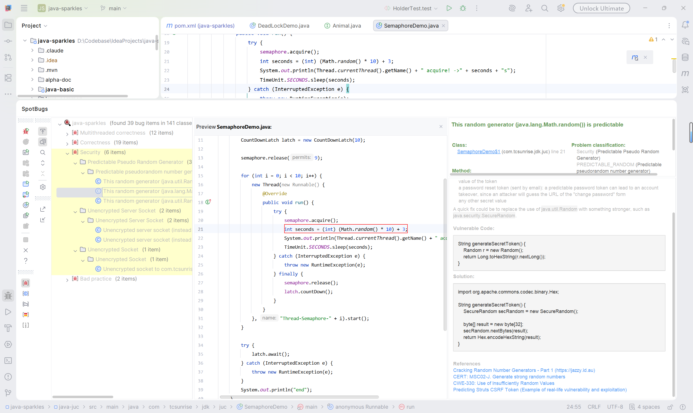
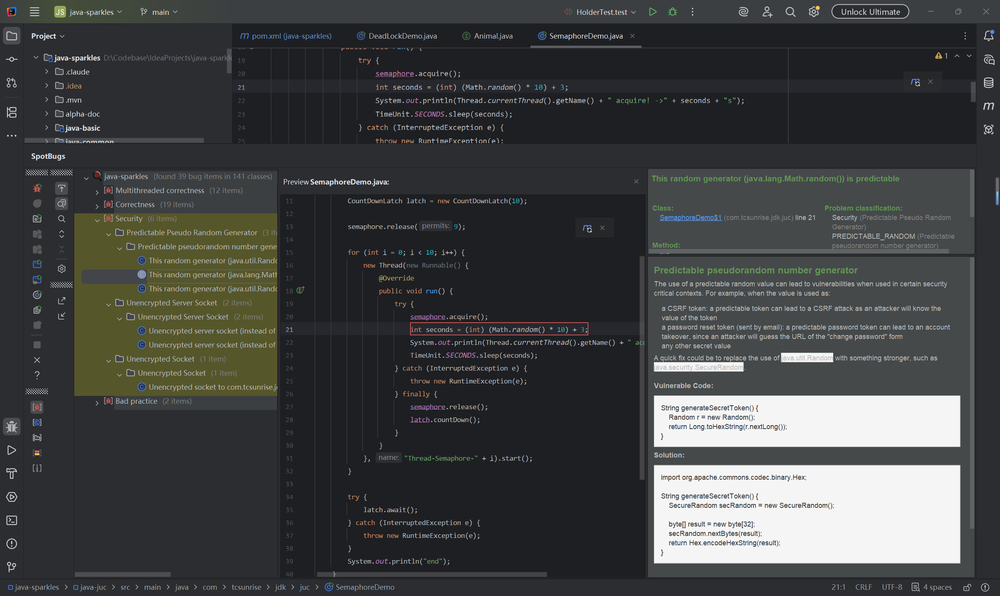

## 写在前面

看了标题，或许会有人反驳现在都是AI Coding了，写代码又快又好，还需要使用额外的工具做代码分析？还需要
用工具去检查代码质量？AI写的代码run起来完全没问题，功能也都正常啊？

如果你认为完全没有必要，全部都丢给AI就行了，那就没有必要继续往下看嘞~

经过最近一年对Claude Code和Codex编程的使用，我发现要想让AI写出逻辑清晰健壮的代码，首先需要给它一个
明确的规范，不然它很容易自己随意发挥；记得有次某个同事用Claude Code写了一堆代码，真的烂的不行，一个
方法300多行，变量命名也是非常费解。究其原因，不是AI能力不行，而是它缺少一套编码规范；如果没有规范限
制AI的发挥，写的代码虽然能跑起来，功能也没问题，但终究可能会出问题，尤其是一些边界条件。如果能前置
地在AI编码期间就给它一套编码规范，让它在有限的规则域内发挥，就更容易产出高质量的代码。

所以，可以完全在项目中接入代码分析工具，限制和协助AI写出质量更优，更健壮的代码，多一道代码质量门禁
是件好事。从个人角度，在这个过程中，也可以让自己见识到更多代码问题，会发现之前自己从来没有想到的问题，
都会被工具暴露出来，提高自己编写健壮代码的能力。


## Why SpotBugs

SpotBugs前身是Maryland大学维护的FindBugs™项目，但是这个项目从2017年开始就不怎么维护了，后来社区
从这个项目fork出来，新项目就叫SpotBugs。相比而言，SpotBugs项目社区维护非常积极活跃，基本上每周都有
多个新的提交合并。

社区活跃性是一方面，SpotBugs有很多著名的大型开源项目都在使用，比如Apache ZooKeeper，Apache Kafka等，
其内部包含了400多种常见的BUG代码模式，这些BUG都可以作为AI的编程工具，输出检查报告喂给AI，实现AI自己
写代码，自己纠正。

同时SpotBugs还支持插件机制，开发团队可以自定义自己的代码检查规则，检查不在内置400多重BUG清单中的代
码模式，进一步扩展其检查代码漏洞的能力。社区也有一些更新很活跃的SpotBugs插件。其中，fb-contrib在
SpotBugs基础上，扩展了300多种BugPattern，而且作者也在定期维护；同时还有一个find-sec-bugs插件，这
个插件是主要是来检查Web应用中常见的安全漏洞，目前项目主页显示已经可以检测超过140多种常见的安全漏洞。

SpotBugs内置的Bug清单和以上两个插件，它们检查的Bug模式以及安全漏洞绝大部分来源于CWE[^cwe]和OWASP[^owasp]目录，
这表明其检测到的代码问题是业界内常见的代码漏洞，使用起来也有据可依，同时还能顺便找到对应的解决方案。

本篇文章介绍SpotBugs的主要使用路径和常用命令，一篇文章无法介绍所有使用细节，更具体更全面的使用方式
需要参考相关官方文档。

## 基本使用

使用SpotBugs的场景主要有三种，分别是系统终端命令行、构建系统集成以及IDE界面开发环境，下面将逐一介绍
每种方式的安装和使用方式。

但是在上手使用之前，我们需要先了解SpotBugs的五个相关的GitHub项目：
- `findbugsproject/findbugs`：SpotBugs的前身，现在基本上社区已经不维护了，上文已有相关介绍；
- `spotbugs/spotbugs`：SpotBugs的核心组件，其它用法都是围绕这个核心构建的；
- `spotbugs/spotbugs-annotations`：SpotBugs代码注解，用于辅助代码分析，比如`SuppressFBWarnings`；
- `spotbugs/spotbugs-maven-plugin`：Maven插件，用于将SpotBugs应用到Maven构建的生命周期中；
- `JetBrains/spotbugs-intellij-plugin`：JetBrains IDEA插件，用于在IDEA中界面化地使用SpotBugs。

### 命令行方式

SpotBugs虽说是用来检查Java程序代码的，但其实其本身也是用Java实现的；它的命令行使用方式和Java业界
其它工具使用方式基本一样，要不就是直接执行jar文件，但是直接执行jar不方便，所以还会附带常见操作系统
的脚本，比如Windows的.bat和.ps1，类Unix系统的.sh脚本，使用相应的平台脚本间接调用jar文件。比如常用
的Apache Maven，Apache ZooKeeper，Alibaba Arthas[^arthas]等，都是这种方式。

在命令行中使用Java命令行工具一般就是通用的三个步骤：
1. 下载分发包压缩文件并解压；
2. 配置系统环境变量，把脚本bin目录配置到系统路径；
3. 在系统终端命令行执行相关命令。

下面介绍一下在Windows上配置命令行调用环境的步骤，其它操作系统类似地可以参考上述步骤（或者询问AI，
比如ChatGPT，豆包，DeepSeek等）。

先从SpotBugs的GitHub Release中下载安装包压缩文件，这里以版本4.10.5为例。SpotBugs 4.10.5下载地
址：<https://github.com/spotbugs/spotbugs/releases#release-4.10.5>

如下图，SpotBugs的Release Assets包含.zip和.tgz两种格式，Windows上下载.zip格式即可。
{: .light .rounded-10 .shadow }
{: .dark .rounded-10 .shadow }

下载完成后会得到压缩文件spotbugs-4.10.5.zip，然后将其解压，得到目录spotbugs-4.10.5。配置Windows
操作系统环境变量`SPOTBUGS_HOME`，变量值为解压得到的完整的目录路径，比如`D:\ISoftware\spotbugs-4.10.5`，
即`SPOTBUGS_HOME=D:\ISoftware\spotbugs-4.10.5`。这一步和配置Maven环境变量`MAVEN_HOME`是一样的类
似操作。

安装的最后一步是配置`PATH`变量，将`%SPOTBUGS_HOME%\bin`配置到系统的`PATH`变量即可。最后打开系统终端
执行`spotbugs -version`，输出版本号就代表安装成功。

由于很少在命令行中直接使用SpotBugs，如果遇到需要在命令行手动执行的情形，参考官方手册里的使用说明即可
[Running SpotBugs](https://spotbugs.readthedocs.io/en/stable/running.html)。


### Maven项目集成

与Maven项目集成是SpotBugs最主要的使用场景，这种情况下方便本地人工触发SpotBugs，进行代码检查和更正，
还可以结合到现有的CI/CD流程中，比如GitLab Pipeline等。

#### 配置依赖

在Maven项目集成SpotBugs比较简单，在根目录的pom.xml文件加上以下两个配置即可：
1. 在dependencies中配置`spotbugs-annotations`依赖；
2. 在pluginManagement中配置`spotbugs-maven-plugin`插件。

定义SpotBugs注解版本和插件版本：
```xml
<properties>
    <spotbugs.version>4.8.6</spotbugs.version>
    <spotbugs-maven-plugin.version>4.8.6.6</spotbugs-maven-plugin.version>
</properties>
```
{: file="pom.xml" }
添加`spotbugs-annotations`依赖，用于在.java源码上添加注释：
```xml
<dependencies>
    <!-- SpotBugs Annotations -->
    <dependency>
        <groupId>com.github.spotbugs</groupId>
        <artifactId>spotbugs-annotations</artifactId>
        <version>${spotbugs.version}</version>
        <scope>provided</scope>
    </dependency>
</dependencies>
```
{: file="pom.xml" }
将`spotbugs-maven-plugin`加入到Maven的构建依赖中，便于通过`mvn`命令触发SpotBugs代码检查：
```xml
<build>
    <pluginManagement>
        <plugins>
            <!-- SpotBugs Maven Plugin -->
            <plugin>
                <groupId>com.github.spotbugs</groupId>
                <artifactId>spotbugs-maven-plugin</artifactId>
                <version>${spotbugs-maven-plugin.version}</version>
                <configuration>
                    <plugins>
                        <plugin>
                            <groupId>com.mebigfatguy.fb-contrib</groupId>
                            <artifactId>fb-contrib</artifactId>
                            <version>7.7.4</version>
                        </plugin>
                        <plugin>
                            <groupId>com.h3xstream.findsecbugs</groupId>
                            <artifactId>findsecbugs-plugin</artifactId>
                            <version>1.12.0</version>
                        </plugin>
                    </plugins>
                </configuration>
                <!-- 为了和SpotBugs Annotations保持版本一致 -->
                <dependencies>
                    <dependency>
                        <groupId>com.github.spotbugs</groupId>
                        <artifactId>spotbugs</artifactId>
                        <version>${spotbugs.version}</version>
                    </dependency>
                </dependencies>
            </plugin>
        </plugins>
    </pluginManagement>
</build>
```
{: file="pom.xml" }
加好以上两个配置后，就成功将SpotBugs能力集成到Maven项目了。

接下来在项目根目录执行以下命令，了解插件提供的goal和相关参数变量，选择需要执行的goal即可：
```bash
# 查看插件有哪些goal
mvn help:describe -Dplugin=com.github.spotbugs:spotbugs-maven-plugin
# 查看goal和详细参数
mvn help:describe -Dplugin=com.github.spotbugs:spotbugs-maven-plugin -Ddetail
```

#### 常用Goal

`spotbugs-maven-plugin`有3个常用的goal：`spotbugs`，`check` 和 `gui`。

- `spotbugs`负责核心的代码静态分析，输出文件报告；
- `check`负责在检查到bug时，输出错误日志，在执行`check`时会先隐式地调用`spotbugs`；
- `gui`负责通过GUI界面化的方式，查看检测到的代码Bug和对应的代码位置。

比如，在项目根目录执行：
```bash
# spotbugs基于字节码分析，所以需要先编译
mvn clean compile spotbugs:check
```
以上命令最后会输出SpotBugs代码检查结果，认为是有问题的代码，SpotBugs将会终止编译构建过程。


### IntelliJ IDEA插件

插件主页：<https://plugins.jetbrains.com/plugin/14014-spotbugs-idea>，安装步骤和其它IDEA插件
一样。

安装好之后，可以通过插件界面查看当前项目代码中的Bug以及源代码位置，如下图：
{: .light .rounded-10 .shadow }
{: .dark .rounded-10 .shadow }
可以看到上图右侧区域，SpotBugs还给出了具体的代码问题分析，包括代码修正方案。


## 进阶用法

SpotBugs支持很多参数，这些参数在以上命令行、Maven插件和IDEA插件三种使用方式中都可以指定，只不过每
种使用方式，指定参数的方式会有所不同。

#### findbugs.xml

在SpotBugs以及其插件中，都会有个`findbugs.xml`文件，这个文件定义了所能识别的Bug或者有问题的代码模
式，例如：spotbugs [findbugs.xml](https://github.com/spotbugs/spotbugs/blob/6816eb256805aa6eed1dced23e6a4aea08cc6660/spotbugs/etc/findbugs.xml)、
sb-contrib™ [findbugs.xml](https://github.com/mebigfatguy/fb-contrib/blob/d07b039b6d474d53b59c1b1b1d257fd765b9b82b/etc/findbugs.xml)、
和find-sec-bugs [findbugs.xml](https://github.com/find-sec-bugs/find-sec-bugs/blob/ba1fa607d0640fda8a26e5479c87c1a98394c6d3/findsecbugs-plugin/src/main/resources/metadata/findbugs.xml)。

从中可以看出，SpotBugs对Bug代码模式从大到小分为了三个层级，分别是：
- **Bug Category**：Bug模式分类。例如BAD_PRACTICE类别：违反代码最佳实践的代码；PERFORMANCE类别：
会对程序性能造成影响的代码等等，_一个Category包括了多个Abbreviation_；
- **Bug Abbreviation**：Bug模式缩写。缩写在Category分出了多个Abbreviation，例如类别BAD_PRACTICE
可分为缩写CN、Co和Dm等；类别PERFORMANCE可以分为缩写Bx、IIL和Dm等，_一个Abbreviation可以归类到多
个Category_；
- **Bug Pattern**：Bug模式。模式是指具体的某一个代码问题，而且往往有对应的CWE ID，例如：Bug模式CN_IDIOM_NO_SUPER_CALL
对应的CWE ID是[CWE-580](https://cwe.mitre.org/data/definitions/580.html)，DMI_EMPTY_DB_PASSWORD
对应的CWE ID是[CWE-259](https://cwe.mitre.org/data/definitions/259.html)。


#### Filter file


Detector


## 相关文档

1. FindBugs™: <https://findbugs.sourceforge.net>
2. SpotBugs: <https://spotbugs.github.io>
3. sb-contrib™: <https://fb-contrib.sourceforge.net>
4. Find Security Bugs: <https://find-sec-bugs.github.io>
5. spotbugs-idea Plugin: <https://plugins.jetbrains.com/plugin/14014-spotbugs-idea>


[^cwe]: CWE: <https://cwe.mitre.org>
[^owasp]: OWASP: <https://owasp.org>
[^arthas]: Alibaba Arthas: <https://arthas.aliyun.com>
